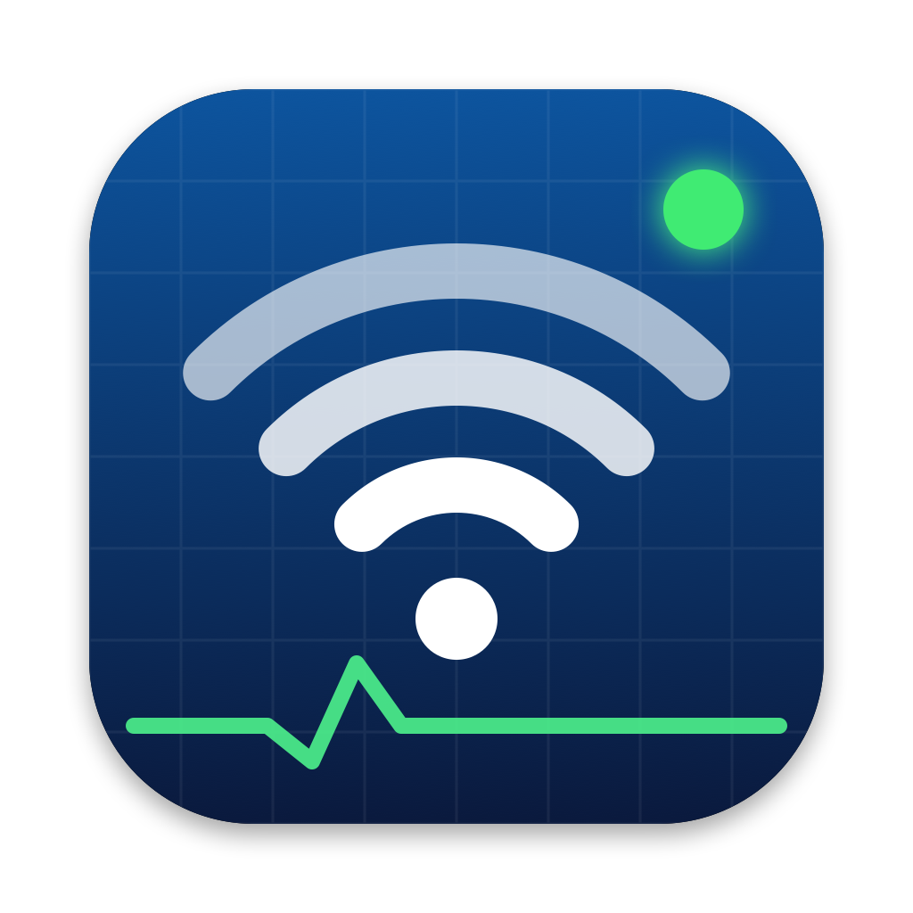

<p align="center">
  
</p>

<h1 align="center">WifiScanner</h1>

<p align="center">
  Analisi Wi-Fi, scansione della LAN e diagnosi di rete per macOS.<br>
  App SwiftUI nativa e strumento da riga di comando, senza dipendenze esterne.
</p>

---

WifiScanner risponde a una domanda pratica: **la connessione va male per colpa del Wi-Fi, del router, del provider, del DNS o della VPN?**

Per rispondere, l'app misura il segnale e la saturazione dei canali, elenca i dispositivi della rete locale e confronta in continuo la latenza verso il router e verso internet. Un motore di diagnosi probabilistico combina queste misure e indica la causa più probabile, con le evidenze che la sostengono.

## Funzioni

### Wi-Fi
- **Saturazione dei canali** a 2.4 GHz e 5 GHz, con grafico e tabella per canale e indicazione dei canali DFS.
- **Reti vicine** con SSID, BSSID, RSSI, sicurezza, PHY e larghezza di canale. Le reti dello stesso AP fisico contano una volta sola.
- **Raccomandazioni**: il canale migliore per ogni banda, confrontato con quello in uso.
- **Collegamento**: SNR, rate, PHY e storico del segnale della rete a cui il Mac è connesso.

### Dispositivi LAN
- Scansione in circa 5 secondi, con ARP, ping ICMP, DNS inverso, Bonjour, UPnP/SSDP e produttore dal prefisso del MAC.
- **LED verde lampeggiante** sui dispositivi che rispondono adesso. Le voci rimaste solo nella cache ARP di macOS appaiono attenuate. Un interruttore mostra solo i dispositivi attivi.
- **Tailscale**: elenca i nodi del tailnet online e le subnet pubblicate dai subnet router e dagli exit node.
- **Storico locale**: data del primo avvistamento, nomi personalizzati e avviso per i dispositivi nuovi. Si svuota con un pulsante, insieme alla cache ARP di macOS se serve.
- **Avvisi di sicurezza**: MAC del gateway cambiato o duplicato, conflitti di indirizzo IP.
- **Per ogni dispositivo**: ping continuo, scansione delle porte, Wake-on-LAN, copia di IP, MAC e hostname dal menu contestuale.

### Diagnostica
- Ping continuo al gateway, a 1.1.1.1 e a 8.8.8.8, con grafico della latenza.
- Test sotto carico con `networkQuality`: throughput e reattività (RPM).
- IP pubblico e provider.
- **Registrazione delle sessioni**: salva le misure in JSON, con etichette e note, per analizzarle e tarare il motore di diagnosi.

## Il motore di diagnosi

Il motore non applica soglie fisse. Ogni misura diventa un grado tra 0 e 1, calcolato su finestre temporali, e la lettura di un valore dipende dal contesto. Per esempio, un RSSI di −70 dBm è accettabile con rumore basso e critico con rumore alto.

- **Modello**: noisy-OR su insiemi di cause, fino a tre cause concomitanti. Il modello spiega da solo i sintomi a valle: se il Wi-Fi è debole, il motore non accusa anche il provider.
- **Cause coperte nel primo rilascio**: segnale debole, canale congestionato, router lento, bufferbloat del router e della linea, perdita sulla linea, interruzioni, DNS lento, exit node VPN lento, interferenza AWDL, più una causa ignota per i casi fuori catalogo.
- **Esiti**: rete sana, diagnosi, causa probabile, ambiguo (con il test che separa le ipotesi), anomalia non riconosciuta, dati insufficienti.
- **Misure pulite**: il motore scarta i campioni presi durante una scansione Wi-Fi e ricomincia l'analisi dopo un cambio di rete o una sospensione del Mac.
- **Validazione**: invarianti verificate su migliaia di scenari sintetici, scenari avversari fuori catalogo e sessioni reali registrate come test di regressione.

La specifica completa, con feature, sintomi, pesi e criteri di accettazione, è in [DIAGNOSI.md](DIAGNOSI.md).

> **Stato:** il motore è in fase di taratura sulle sessioni reali e non è ancora collegato all'interfaccia.

## Requisiti

- macOS 15 Sequoia o successivo
- Swift 6.2, incluso in Xcode 26 o nei Command Line Tools

## Compilare

```bash
swift build -c release
```

Il comando produce `.build/release/wifiscan` (CLI) e `.build/release/WifiScannerApp` (app).

### Creare il bundle dell'app

macOS mostra SSID e BSSID solo a un'app con bundle, firma e permesso di localizzazione.

```bash
mkdir -p WifiScanner.app/Contents/{MacOS,Resources}
cp Resources/Info.plist WifiScanner.app/Contents/
cp Resources/AppIcon.icns WifiScanner.app/Contents/Resources/
cp .build/release/WifiScannerApp WifiScanner.app/Contents/MacOS/WifiScanner
cp .build/release/wifiscan_WifiScanCore.bundle/oui.plist WifiScanner.app/Contents/Resources/
codesign --force --deep --entitlements WifiScanner.entitlements --sign - WifiScanner.app
open WifiScanner.app
```

`--sign -` firma l'app in modo locale, valido solo sul tuo Mac. Per distribuirla serve un certificato Developer ID e la notarizzazione: i passaggi sono in [USO.md](USO.md).

Al primo avvio macOS chiede l'accesso alla posizione. Senza questo permesso l'app non vede i nomi delle reti, ma il resto funziona. In alternativa, le Impostazioni dell'app accettano SSID e canale inseriti a mano.

## Riga di comando

```bash
.build/release/wifiscan -e                   # scansione e raccomandazioni
.build/release/wifiscan -c                   # scansione continua ogni 10 s
.build/release/wifiscan --my-ssid CasaMia -e # indica la tua rete per nome
```

| Opzione | Effetto |
|---|---|
| `-c`, `--continuous` | Ripete la scansione ogni 10 s |
| `-e`, `--explain` | Mostra le raccomandazioni |
| `--my-ssid <SSID>` | Identifica la tua rete per nome |
| `--my-bssid <BSSID>` | Identifica la tua rete per BSSID |
| `--my-channel <N>` | Usa la rete più forte sul canale indicato |
| `-h`, `--help` | Mostra l'aiuto |

## Test

```bash
swift test
```

La suite comprende test unitari, invarianti del motore su scenari generati e le sessioni reali in `Tests/WifiScanCoreTests/Diagnosis/Fixtures`. Un'invariante di monotonia su una causa (W6) ha ancora poche violazioni note, in corso di correzione.

## Privacy

- I dati restano sul Mac. Lo storico dei dispositivi è in `~/Library/Application Support/WifiScanner/wifiscan.sqlite`, le sessioni registrate nella cartella `Sessions` accanto.
- L'app contatta solo i servizi che servono alle misure: `ipinfo.io` per IP pubblico e provider, `speed.cloudflare.com` per il test di velocità, i server di Apple usati da `networkQuality`, e 1.1.1.1 e 8.8.8.8 come bersagli di ping e DNS.
- Nelle sessioni registrate i BSSID sono sostituiti da pseudonimi.

## Struttura

```
Sources/
  WifiScanCore/        Libreria condivisa: scansione Wi-Fi, LAN, misure, persistenza
    Diagnosis/         Motore di diagnosi: misure, feature, sintomi, catalogo, inferenza
  WifiScannerApp/      App SwiftUI
  wifiscan/            CLI
Tests/                 Test unitari, invarianti e sessioni reali
Resources/             Info.plist e icona del bundle
scripts/make-icon.swift  Genera l'icona
design/                Riferimenti del redesign grafico
DIAGNOSI.md            Specifica del motore di diagnosi
USO.md                 Note operative: firma, notarizzazione, logica di scoring
```
